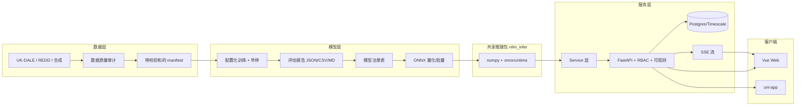

# NILM 系统完善路线图（v0.1）

> **定位**：从"能演示的 Demo"升级为"可复现、可验证、可交付的毕业设计系统"。
> **范围**：`ml/` `backend/` `web/` `mobile/` `adapters/` `data/` `scripts/` 与文档。
> **结论先行**：端到端链路已经打通，但**模型没真正学会、指标不可复现、数据链路不可持续、工程缺少护栏**。建议按 P0 止血 → 数据与模型 → 后端工程化 → 实时与前端 → 交付与论文 五步推进。

## 0. 执行进展（2026-11-11）

阶段 0（P0 止血）已全部完成，并额外完成"真实数据 + 最简单训练 + 前端/移动端真实化"：

- ✅ 真实数据：UK-DALE house 1（6 个月、6 s、260 万样本）+ WHITED（994 FLAC）
- ✅ 训练与导出：attention / baseline，ONNX parity 全部通过
- ✅ 指标真实化：评测页/报表不再有硬编码分数，全部来自 13,013 个测试窗口
- ✅ 缓存键、UTC 时区、`/readyz`、DB 唯一约束、告警冷却、输入上限
- ✅ Web 构建通过；移动端 H5 构建通过且**界面全英文**
- ⏳ 待办：P1（测试/CI/Alembic/RBAC/SSE）与 P2（量化/跨房屋/WHITED 实验）

详见 [MIDTERM_STATUS.md](MIDTERM_STATUS.md)。下文的 P0 清单保留为问题记录，便于论文"问题—解决"章节引用。

---

## 1. 现状盘点

| 模块 | 已具备 | 成熟度 |
|------|--------|--------|
| 数据 | 合成数据生成、UK-DALE 加载器、HDF5 分窗、manifest | 骨架可用，数据不可信 |
| 模型 | Seq2Point baseline / dilated / attention / seq2seq、加权 Huber | 结构完整，训练与评估有断点 |
| 部署 | ONNX 导出 + 形状校验、ONNX Runtime 推理 | 可用，未量化、未批量化 |
| 后端 | 8 个路由模块、JWT、异步任务、缓存、告警 | 功能齐全，缺迁移/授权/可观测 |
| Web | Dashboard / Evaluation / Analytics、vue-i18n、ECharts | 页面完整，含硬编码与假数据 |
| 移动端 | uni-app 5 页、uCharts、JWT | 可运行，接口有 1 处断裂 |
| 适配器 | Replay 已跑通；MQTT/Modbus 为 stub | 仅 Replay 可用 |
| 质量保障 | —— | **无测试、无 CI、无迁移、无 lint** |

---

## 2. 核心判断（三条）

1. **演示可信度是当前最大风险，不是功能缺失。** 页面上的"改进模型 88/94 分""Inference Speed""本月账单"都是写死的，答辩时一问即穿。
2. **算法结论目前不成立。** 测试集只有 21 个窗口；5 个电器里 4 个 F1=0；attention 在冰箱上 MAE(29.6) 反而比 baseline(27.7) 差。论文若直接引用这张表会被质疑。
3. **数据链路不可持续。** 无唯一约束、无保留策略，本地库已 50.6 万行、5.9 万条重复、249 个任务永不清理；一次 replay 重启就继续叠加。

---

## 3. 问题清单

### 3.1 P0 — 阻断级（答辩前必须修）

| # | 问题 | 证据 | 影响 | 修复方向 |
|---|------|------|------|----------|
| P0-1 | 训练/评估流水线当前**跑不通** | [metrics.py:79](ml/train/metrics.py#L79) 产出 `state_f1`/`event_f1`，而 [train_all.py:50](ml/train/train_all.py#L50)、[recompute_ablation.py:47](ml/eval/recompute_ablation.py#L47) 仍取 `f1`/`accuracy` → KeyError（已实测） | 训练完在写表时崩溃，消融表无法重算 | 统一指标 schema，加 schema 单测，两个脚本适配 |
| P0-2 | 评估集小到无统计意义 | `data/processed/*_test.h5` 实测 `x=(21,599)`，val 也是 21 | F1 在 0/1 之间跳变，任何结论都不可靠 | test stride ≤16、至少 1 周 holdout、打印每电器样本数 |
| P0-3 | 算法结论不成立 | [ablation_metrics.json](ml/checkpoints/ablation_metrics.json)：kettle/microwave/dishwasher/washing_machine 的 F1 全为 0，4/5 个 SAE=1.0；冰箱 attention MAE 29.6 > baseline 27.7 | "改进模型更优"无法支撑 | 阈值搜索 + 正样本加权 + 更长数据 + 如实报告 |
| P0-4 | 评估页数据伪造/口径失真 | [analytics.py:168-182](backend/app/routers/analytics.py#L168-L182) 写死 `80/70` 与 `88/94`；[analytics.py:157-159](backend/app/routers/analytics.py#L157-L159) 把瓦特单位的 MAE 直接映射成 0–100 分（洗碗机 114W 被截到 0 分），且 F1 维度因 4 个电器为 0 而接近 0 | 雷达图既不可比也不可信，答辩一问即穿 | 改为实测延迟与真实消融；无数据就不展示该维度 |
| P0-5 | 分解缓存键错误 | [disaggregation.py:52](backend/app/routers/disaggregation.py#L52) 只按 `start.date()` 做 key；[inference.py:150-164](backend/app/services/inference.py#L150-L164) 按 `(meter, period)` 缓存 | 同一天任意 2h 窗口都返回当天第一次的结果，曲线与请求区间不符 | key 改为 `(meter_id,start,end,model_version)` + TTL + 显式失效 |
| P0-6 | 时区错乱 | 模型存 naive 时间（[models.py:89](backend/app/models.py#L89)），API `.isoformat()` 无 `Z`（[inference.py:111](backend/app/services/inference.py#L111)），前端 `new Date(...)` 按本地解析（[disaggregation.js:42](web/src/api/disaggregation.js#L42)） | 东八区图表整体偏移 8 小时 | 全链路 UTC-aware，API 统一 `Z`，前端按 locale 渲染 |
| P0-7 | Docker 里跑的不是模型 | [Dockerfile:5-7](backend/Dockerfile#L5-L7) 只 COPY `app`；[inference.py:17-19](backend/app/services/inference.py#L17-L19) 依赖 `/ml` 才能 import；容器内 `ROOT="/"` → ImportError → 启发式兜底（且 `except Exception` 静默） | 演示环境实际输出启发式结果，却展示 ONNX 指标 | 抽独立 `nilm_infer` 包；`/readyz` 返回后端类型与模型清单 |
| P0-8 | 合成数据过于理想 | [generate_synthetic.py:55-57](ml/preprocess/generate_synthetic.py#L55-L57)：`aggregate = base + Σappliances`，无噪声、无重叠、单状态方波 | 模型学到的是"减法"而非真实可分性 | 多状态、噪声、并发事件、真实时长分布 |
| P0-9 | 多处分析数字是占位符 | [analytics.py:47-48](backend/app/routers/analytics.py#L47-L48) 今日=`功率×12`、本月=`×30`；[analytics.py:79](backend/app/routers/analytics.py#L79) 电价写死 0.6；[appliances.py:152-159](backend/app/routers/appliances.py#L152-L159) 用量=`额定×2.5`；[disaggregation.py:142](backend/app/routers/disaggregation.py#L142) `latency=4.2` | 所有"账单/用量/延迟"均不可溯源 | 改为按时间戳积分 + 可配置电价 + 实测延迟 |

### 3.2 P1 — 工程化（决定能否长期维护）

| # | 问题 | 证据 | 修复方向 |
|---|------|------|----------|
| P1-1 | 无任何自动化测试与 CI | 全仓库无 `tests/`；无 workflow | pytest + httpx + Vitest + Playwright + GitHub Actions |
| P1-2 | 无数据库迁移 | [main.py:14](backend/app/main.py#L14) `create_all` | Alembic，首版基线迁移 |
| P1-3 | 无授权模型 | 全部接口只校验"已登录"；角色字段从不使用；任意用户可删建筑（[buildings.py:82-93](backend/app/routers/buildings.py#L82-L93)） | RBAC + 资源级校验（building_id 归属） |
| P1-4 | 会话不可撤销 | [auth.py:43-46](backend/app/routers/auth.py#L43-L46) logout 无副作用；refresh 可无限复用 | refresh 轮换 + 黑名单/版本号 |
| P1-5 | 默认密钥与弱口令 | [config.py:12](backend/app/config.py#L12) 内置 JWT secret；[seed.py:30](backend/app/seed.py#L30) `admin123` | 启动强校验、必须来自 env、首次登录改密 |
| P1-6 | CORS 配置非法 | [main.py:31-37](backend/app/main.py#L31-L37) `allow_origins=["*"]` + `allow_credentials=True` 会被浏览器拒绝 | 白名单 + 按环境配置 |
| P1-7 | 事件/告警风暴 | [measurements.py:119-146](backend/app/routers/measurements.py#L119-L146) 每个超阈值样本都写一条 Alert | 冷却窗口 + 去重 + 生命周期（ack/resolve） |
| P1-8 | 数据可无限增长且重复 | 实测 506,370 行 / 447,330 唯一（**5.9 万重复**）、249 任务、时间跨度 2025-09→2026-10；`measurements` 无 `(meter_id,timestamp)` 唯一约束与复合索引 | 唯一约束 + 复合索引 + 保留/降采样策略 |
| P1-9 | 分页与输入无上限 | `size` 可传任意大；时间区间无限制 | `size<=500`、区间<=31 天、批量<=N |
| P1-10 | 同步推理阻塞请求 | [disaggregation.py:61](backend/app/routers/disaggregation.py#L61) GET 内直接跑模型 | 只读缓存 + 异步任务 + 超时/取消 |
| P1-11 | 契约漂移 | `openapi/NILM.json` 是 `POST /analytics/reports`（实现是 GET），缺 `/disaggregation/overview`、`/analytics/evaluation`；`API.md` 写了不存在的 `/meters/{id}/current`，移动端正好在调它（[api.js:46-48](mobile/src/utils/api.js#L46-L48)） | 以 FastAPI 生成为唯一事实源 |
| P1-12 | 无日志/异常处理 | 无 request-id，异常直接 500，[inference.py:50](backend/app/services/inference.py#L50) 静默吞异常 | structlog + 全局异常处理器 + Problem Details |
| P1-13 | 配置散落 | 电价 0.6、building=1、meter=101、阈值 3000、窗口 599 分散在前后端与文档 | 统一 `settings` + `/config` 下发 |
| P1-14 | 轮询即全量重算 | [Dashboard.vue:77-111](web/src/views/Dashboard.vue#L77-L111) 每 15s 触发 `run` + `result` + `overview` | SSE/WS + 增量推理 + 仅新样本入窗 |
| P1-15 | 前端无状态反馈 | 仅 `console.error`，无 loading/error/empty；`ApplianceGrid` 开关可点但无后端语义（[ApplianceGrid.vue:7](web/src/components/ApplianceGrid.vue#L7)） | 骨架屏 + 全局 toast + 状态徽标 |
| P1-16 | i18n 与样式缺陷 | [index.js:21,59](web/src/i18n/index.js#L21) 重复 `kpi` 键（后者覆盖）；Login 页硬编码中文（[Login.vue:7-17](web/src/views/Login.vue#L7-L17)）；`el-col :span="4.8"` 非法（[ApplianceGrid.vue:3](web/src/components/ApplianceGrid.vue#L3)） | 去重 + 补全 + 修正布局 |
| P1-17 | 仓库噪音与不可复现 | `.DS_Store`/`._*` 已入库；`Ensure`/`Start`/`Wait`/`._NILM` 垃圾文件；[.gitignore:14-17](.gitignore#L14-L17) 排除数据与模型，新克隆无法运行 | 清理 + bootstrap 脚本 + 校验和清单 |

### 3.3 P2 — 增强项（论文亮点 / 体验）

| # | 问题 | 证据 | 修复方向 |
|---|------|------|----------|
| P2-1 | 推理未批量、未量化 | [engine.py:80-91](ml/inference/engine.py#L80-L91) 逐点 Python 循环；模型 39MB（attention）/122MB（baseline），5 电器约 196MB | 批量窗口 + `onnxsim` + INT8，输出 大小/延迟/MAE 对比表 |
| P2-2 | 无泛化实验 | [generalization.csv](ml/eval/thesis_exports/generalization.csv) 是占位 | house1→house2 跨房屋、REDD 跨数据集 |
| P2-3 | 无模型版本管理 | 文件散落在 `ml/checkpoints/`，靠文件名约定 | 模型注册表（DB 表 + API + UI 展示版本/数据集/日期） |
| P2-4 | 告警无生命周期 | `Alert.resolved` 字段从未被 API 使用 | ack/resolve/静默规则 |
| P2-5 | 真实电表未验证 | MQTT/Modbus 是 stub，无重连/背压 | 本地 broker/modbusserver 打通一次 |
| P2-6 | 移动端薄弱 | uni-app alpha 版本、调用不存在接口、无类型 | 对齐 API、升级稳定版、抽共享 SDK |
| P2-7 | 无用户/审计 | 仅种子 admin | 用户 CRUD + 操作审计 |
| P2-8 | 无数据导出/报告 | —— | CSV/PDF 用电报告 |

---

## 4. 目标状态与验收标准

### 4.1 六个"完成定义"

| 维度 | 验收标准 |
|------|----------|
| **可信** | 页面上每个数字都能追溯到 DB 查询或 `metrics.json`；全局搜索无硬编码指标 |
| **可复现** | 空机器执行 `scripts/bootstrap` + `scripts/demo` 即可复现全部图表；数据与模型有校验和；训练固定 seed |
| **可验证** | 后端 pytest 核心覆盖率 ≥70%；前端 Vitest + Playwright 冒烟；CI 全绿 |
| **可运行** | 1 Hz 连续 24 h 不崩、内存平稳；DB 增长率可控（保留策略生效） |
| **可解释** | 每电器 MAE/SAE/state-F1/event-F1 + 实测延迟/内存 + 模型版本，可在 UI 查看 |
| **可扩展** | 新增电器/数据集 = 配置 + 训练 + 注册，不改后端代码 |

### 4.2 目标架构（关键变化）

**结构性改动**：把 `ml/inference` 抽成独立 Python 包 `nilm_infer`，`ml` 与 `backend` 同时安装依赖，彻底消除 `sys.path` hack 与 P0-7。

---

## 5. 分阶段实施计划

### 阶段 0：止血与真实性（3–5 个工作日）

> 目标：让"现在展示的东西"全部真实、可复现。不追求功能新增。

- [ ] **0.1 修指标契约**：`evaluate_all` 输出统一为 `mae/sae/state_*/event_*`；`train_all`、`recompute_ablation` 适配；加 `test_metrics_schema.py`；`train_all` 记录 **best** checkpoint 的指标而非最后一轮。
- [ ] **0.2 重建评估集**：test `stride ≤16`（建议 8，兼顾样本量与原文件体积），val 独立一日；至少 7 天数据；打印每电器正样本比例与窗口数。
- [ ] **0.3 去假数据**：删除 `80/70/88/94`；`/analytics/metrics` 返回 `{appliance, model, split, mae, sae, state_f1, event_f1, latency_ms, params, size_mb}`；无泛化数据时前端隐藏该维度；`100-MAE` 改归一化或直接显示原始值。
- [ ] **0.4 修缓存与区间**：缓存键 `(meter_id,start,end,model_version)`；GET 只读缓存（miss 返回 202 + task）；TTL + 失效接口。
- [ ] **0.5 修时区**：`DateTime(timezone=True)`、统一 `Z` 输出、前端 `Intl.DateTimeFormat` 按 locale 渲染。
- [ ] **0.6 修 Docker 与自检**：抽 `nilm_infer` 包；`/readyz` 返回 `{db, model_backend, appliances, model_version}`；模型缺失时 fail fast 或 UI 明确标注"启发式"。
- [ ] **0.7 修数据**：一次性去重脚本（59k 行）+ `(meter_id,timestamp)` 唯一约束 + 复合索引 + 任务清理；补 Alembic 基线。

**验收**：`train_all → export → 后端 → 页面` 全链路重跑，所有数字来自文件；`curl /readyz` 显示 `onnx` 而非 `heuristic`；Docker 内一致。

### 阶段 1：数据与模型可信化（10–15 个工作日）

- [ ] **1.1 真实数据接入**：优先自写 UK-DALE HDF5 reader（规避 NILMTK 依赖地狱），house1/house2；下载脚本 + md5 校验。
- [ ] **1.2 数据质量审计** `ml/preprocess/audit.py`：缺失率、负值、尖峰、重叠、覆盖率，输出报告进 manifest。
- [ ] **1.3 合成数据 2.0**：多状态电器（洗衣机分阶段功率）、并发事件、测量噪声、真实时长分布、独立随机种子。
- [ ] **1.4 训练框架**：YAML 配置、`seed_everything`、早停、余弦调度、AMP、断点续训、CSV/TensorBoard 日志。
- [ ] **1.5 训练策略**：加权 Huber + 每电器阈值搜索（最大化 event-F1）+ 可选的二阶段（分类头辅助）。
- [ ] **1.6 评估协议**：全量 test、event-level P/R/F1、bootstrap 置信区间、跨房屋泛化；`ml/eval/report.py` 一键生成三件套。
- [ ] **1.7 导出与压缩**：动态 batch、`onnxsim`、INT8 量化，产出 `{size, latency, mae}` 对比表。
- [ ] **1.8 模型注册**：`model_registry` 表 + API + UI 展示活动版本、训练日期、数据集版本。

**验收**：一张"5 电器 × 3 模型 × 2 指标 + 置信区间"的表，能一键复现；跨房屋结果真实存在；模型体积下降 ≥50% 且 MAE 退化 <5%。

### 阶段 2：后端工程化（8–10 个工作日）

- [ ] **2.1 分层重构**：`routers → services → repositories`；Pydantic 严格模式；统一响应/异常。
- [ ] **2.2 数据层**：Alembic 迁移、复合索引、唯一约束、Timescale 超表、降采样与保留策略。
- [ ] **2.3 安全**：RBAC（system_admin / building_admin / tenant）+ 资源级校验；refresh 轮换 + 黑名单；密码策略；登录限流；CORS 白名单；启动时校验 secret。
- [ ] **2.4 事件与告警**：冷却窗口去重、规则配置化、ack/resolve API、通知钩子。
- [ ] **2.5 可观测**：structlog + request-id + 统一异常处理 + `/healthz` `/readyz` `/metrics`。
- [ ] **2.6 任务系统**：任务超时/重试/取消；并发上限；可选 ARQ + Redis。
- [ ] **2.7 输入防护**：分页上限、区间上限、批量上限、时间戳合法性。
- [ ] **2.8 测试**：pytest + httpx + 临时 SQLite；覆盖 auth/buildings/meters/measurements/disaggregation；覆盖率门槛进 CI。
- [ ] **2.9 契约**：以 FastAPI 生成的 OpenAPI 替换手写 `openapi/NILM.json`；CI 校验。

**验收**：`pytest` 全绿且覆盖率达标；越权访问返回 403；告警 10 分钟内不重复；日志可按 request-id 串联。

### 阶段 3：实时性与前端完善（8–10 个工作日）

- [ ] **3.1 实时通道**：SSE `/api/v1/stream/meters/{id}`；后端环形缓冲 + 仅新窗口推理。
- [ ] **3.2 性能**：内存 LRU（可选 Redis）；结果分页；大区间异步 + 进度。
- [ ] **3.3 前端健壮性**：loading/error/empty/骨架屏；401 自动刷新并重放；全局错误提示。
- [ ] **3.4 新页面**：设备管理（CRUD）、告警中心、模型与数据版本、数据质量。
- [ ] **3.5 细节修复**：时区、状态徽标替代可编辑开关、i18n 去重与补全、`el-col`、账单口径、图表单位/缩放。
- [ ] **3.6 前端质量**：ESLint + Prettier、Vitest 组件测试、Playwright 冒烟（登录→Dashboard→切换电表→分解→告警）。
- [ ] **3.7 响应式与可访问性**：移动端断点、键盘可达。

**验收**：页面不再轮询全量重算；新增数据 <2s 出现在图表；Lighthouse 性能 ≥85。

### 阶段 4：交付与论文材料（5 个工作日）

- [ ] **4.1 脚本重写**：`bootstrap` / `demo` / `test` 幂等、检查版本、端口检测、健康等待、日志落盘、优雅退出。
- [ ] **4.2 编排**：dev（SQLite）+ prod（Postgres/Timescale + nginx + 健康检查 + 资源限制）。
- [ ] **4.3 CI**：lint + typecheck + test + build + docker build，缓存加速。
- [ ] **4.4 文档**：README（5 分钟跑通）、`ARCHITECTURE.md`、`DATASET.md`、`MODEL_CARD.md`、`SECURITY.md`、`CHANGELOG.md`。
- [ ] **4.5 论文素材**：消融表、泛化表、延迟/内存/体积表、系统截图、复现命令清单。
- [ ] **4.6 答辩包**：演示分镜、Q&A 预案（含"为什么指标不高""用了什么真实数据"）。

---

## 6. 时间线与两种轨道

| 周 | 阶段 0 | 阶段 1 | 阶段 2 | 阶段 3 | 阶段 4 |
|----|--------|--------|--------|--------|--------|
| W1 | ██ | | | | |
| W2 | | ██ | | | |
| W3 | | ██ | | | |
| W4 | | ██ | ██ | | |
| W5 | | | ██ | | |
| W6 | | | ██ | ██ | |
| W7 | | | | ██ | |
| W8 | | | | | ██ |

- **轨道 A（答辩优先，约 3 周）**：阶段 0 全量 + 1.1/1.2/1.4/1.5/1.6/1.7 + 4.5/4.6。
  产出：数字真实、模型可复现、材料齐全。**建议至少走这条。**
- **轨道 B（工程完整，约 8 周）**：A + 阶段 2 + 3 + 4.1–4.4。
  产出：可作为长期项目/开源仓库继续演进。

---

## 7. 关键技术决策（需确认）

| # | 决策 | 选项 | 建议 |
|---|------|------|------|
| D1 | 真实数据 | 有 UK-DALE / 有 REDD / 都没有 | **有则必用 house1+2**；没有则把"仅合成数据"写进论文局限 |
| D2 | 数据加载 | NILMTK / 自写 HDF5 reader | **自写**（NILMTK 与新版 pandas/numpy 冲突多） |
| D3 | 数据库 | 继续 SQLite / Postgres+Timescale | 演示 SQLite，压测与交付用 Postgres |
| D4 | 实时通道 | SSE / WebSocket | **SSE**（单向、实现简单、Nginx 友好） |
| D5 | 任务队列 | BackgroundTasks / ARQ+Redis | 先加超时与并发上限，量大再上 ARQ |
| D6 | 指标主口径 | state-F1 / event-F1 | **两者都报**，答辩主讲 event-F1 |
| D7 | 遗留模块 | 保留 / 归档 `legacy_nilm` 与 `mobile` | 归档到 `archive/`，不进演示路径 |
| D8 | 演示范围 | Web-only / Web+移动端 | 维持 Web 主演示，移动端仅 smoke test |

---

## 8. 风险与对策

| 风险 | 概率 | 影响 | 对策 |
|------|------|------|------|
| 真实数据训练效果不如合成数据 | 中 | 高 | 提前跑 baseline 对比，论文如实报告并讨论域差异 |
| UK-DALE 下载慢/磁盘不足（约 5–10GB） | 中 | 中 | 只取 house1/2 的目标通道，边下边转 |
| 改动引发演示回归 | 中 | 高 | 每阶段打 tag，Playwright 冒烟守护主路径 |
| 时间不足 | 高 | 高 | 轨道 A 保底；P0 优先于一切新功能 |
| 依赖升级破坏环境 | 中 | 中 | 锁版本 + `uv`/`pip-tools` 生成锁文件 |
| 指标仍不理想 | 中 | 中 | 用 event-F1 与阈值搜索改善；论文聚焦"系统 + 工程贡献" |

---

## 9. 立即可执行的首批任务（本周 6 个 PR）

1. **PR1** 指标契约修复：`metrics.py` + `train_all` + `recompute_ablation` + 单测。
2. **PR2** 评估集重建 + `preprocess/audit.py` + 样本数/正例率打印。
3. **PR3** 删除硬编码指标，新增 `/analytics/metrics`，前端接真实数据。
4. **PR4** 缓存键 + 时区修复（后端 + 前端）。
5. **PR5** Docker 修复 + `/readyz` 模型状态。
6. **PR6** DB 去重脚本 + 唯一约束 + Alembic 基线。

> 这 6 个 PR 完成后，系统即从"演示可用"变为"数字可信"，后续算法与工程改造才有意义。

---

## 10. 非目标（明确不做）

- 三相不平衡/谐波级分析、HVAC 变频器精细建模。
- 真实电网并网、边缘硬件驱动开发。
- 多租户计费与商业化。
- 移动端上架与深度打磨。

---

*版本：v0.1 ｜ 基于 2026-11 代码库实况（含实测：test 21 窗口、DB 50.6 万行/5.9 万重复、指标 KeyError）*
