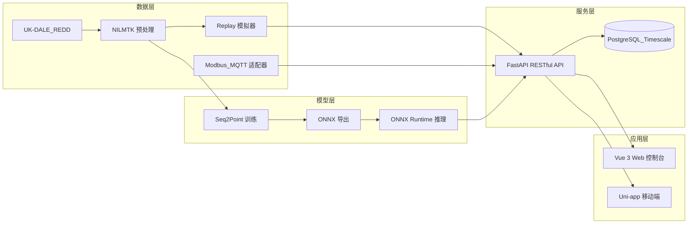

# 建筑级非侵入式负荷监测系统（NILM）项目计划书

## 一、项目背景与意义

### 1.1 研究背景

随着智能电网、智慧建筑和"双碳"目标的推进，建筑能耗精细化管理成为研究热点。据统计，建筑能耗约占全社会总能耗的 30% 以上，而电器设备用电是建筑能耗的主要组成部分。传统的侵入式负荷监测需要在每台电器上安装独立传感器，部署成本高、维护复杂、扩展性差。

非侵入式负荷监测（Non-Intrusive Load Monitoring, NILM）技术仅通过在建筑总入口安装一块智能电表，采集总电压、电流、功率等信号，再利用信号处理与机器学习算法将总负荷分解为各电器的用电状态与能耗，具有成本低、部署便捷、用户接受度高等优势。

### 1.2 研究意义

- **节能减排**：帮助用户识别高能耗电器，优化用电行为。
- **安全保障**：检测异常用电、过载、电器故障等安全隐患。
- **智能运维**：为建筑能源管理系统提供细粒度数据支撑。
- **降低成本**：相比侵入式方案，大幅减少传感器部署与维护成本。

---

## 二、国内外研究现状

### 2.1 国外研究现状

国外 NILM 研究起步较早。Hart（1992）首次提出 NILM 概念，利用有功功率 P 和无功功率 Q 的变化进行负荷识别。后续研究逐渐引入：

- **NILMTK 工具包**：由 BATRA 等人开发，成为 NILM 领域的标准数据处理框架。
- **公开数据集**：UK-DALE、REDD、AMPds、REFIT 等为算法研究提供了数据基础。
- **深度学习方法**：Seq2Point、Seq2Seq、Denoising Autoencoder、Transformer 等网络结构在负荷分解任务中表现优异。

### 2.2 国内研究现状

国内研究主要集中在：

- 基于改进神经网络的负荷分解算法。
- 面向居民建筑、校园建筑、商业建筑的能耗监测应用。
- 边缘计算与云边协同的 NILM 部署方案。

但现有研究多停留在算法层面，完整的建筑级 NILM 系统（数据→模型→后端→前端）集成度不足。

### 2.3 现有不足

- 算法泛化能力弱，跨建筑、跨数据集迁移困难。
- 缺乏完整工程化系统，难以实际部署。
- 实时性与可解释性不足。

---

## 三、研究目标

本项目旨在设计并实现一套**建筑级非侵入式负荷监测系统**，完成从数据预处理、模型训练、模型部署、后端服务到 Web 可视化控制台的全链路实现。具体目标包括：

1. 构建基于 UK-DALE/REDD 的数据预处理流程，生成标准化训练样本。
2. 实现 Seq2Point 基线模型，并引入空洞卷积（Dilated Conv）与注意力机制进行改进。
3. 将训练好的模型导出为 ONNX 格式，利用 ONNX Runtime 实现高效推理。
4. 基于 FastAPI 实现 RESTful 后端服务，支持建筑、楼层、区域、电表、测量数据、事件、家电、负荷分解与分析等模块。
5. 开发 Vue 3 Web 控制台，实现 Dashboard、Evaluation、Analytics 三大核心页面。
6. 实现模拟电表数据重放器，并预留 Modbus/MQTT 真实电表适配接口。
7. 提供一键启动的 Demo 脚本，支撑答辩现场演示。

---

## 四、研究内容

### 4.1 数据预处理

- 使用 NILMTK 加载 UK-DALE/REDD 数据集。
- 数据清洗：去除负值、异常尖峰，对齐时间戳，插值短间隙，删除长间隙。
- 保持 1 Hz 低频采样。
- 滑动窗口构建：窗口长度 W=599，标签为窗口中点时刻的电器功率（Seq2Point）。
- 数据集划分：训练集 70%、验证集 15%、测试集 15%。
- 数据标准化：对 aggregate 和各 appliance 功率分别做 z-score 标准化。
- 当真实数据集不可用时，提供合成数据生成器保证系统可运行。

### 4.2 负荷分解模型

#### 4.2.1 基线 Seq2Point

- 5 层 Conv1D + Dropout + Dense(1024) + Dense(1)。
- 每个电器单独训练一个模型（N-to-1）。

#### 4.2.2 改进模型

- **空洞卷积（Dilated Convolution）**：扩大感受野，捕获长期时序依赖。
- **时序/通道注意力机制**：增强关键时间步与关键通道的权重。
- **损失函数优化**：Huber 损失 + 正样本加权，缓解电器开关状态不平衡。

#### 4.2.3 评估指标

- MAE（平均绝对误差）
- SAE（能量累计相对误差）
- Accuracy / F1（基于功率阈值判断开关状态）

### 4.3 模型部署

- 使用 PyTorch 训练模型。
- 导出为 ONNX 格式，每个电器一个模型。
- 推理引擎基于 ONNX Runtime，输入最近 W 个 aggregate 功率采样点，输出中点时刻的电器功率。
- 支持批量滑动窗口推理，生成日电器能耗曲线。

### 4.4 后端服务

基于 FastAPI 实现，模块包括：

| 模块 | 核心功能 |
|------|---------|
| Auth | JWT 登录/登出/刷新，角色权限 |
| Buildings | 建筑、楼层、区域的 CRUD |
| Meters | 电表管理、当前读数 |
| Measurements | 实时数据、历史查询、批量上传 |
| Events | ON/OFF/state_change 事件记录 |
| Disaggregation | 提交分解任务、查询任务状态、获取分解结果 |
| Appliances | 家电清单管理 |
| Analytics | 建筑概览、分项账单、告警、模型评估报告 |

数据库使用 PostgreSQL/TimescaleDB（Docker 部署）或 SQLite（本地快速开发）。

### 4.5 Web 可视化控制台

基于 Vue 3 + Element Plus + ECharts：

- **Dashboard**：建筑/电表选择器、实时总功率曲线、家电分解曲线、家电状态网格。
- **Evaluation**：Baseline vs Proposed 雷达图、模型改进说明。
- **Analytics**：分项用电账单、安全阈值配置、告警日志。

### 4.6 数据适配器

- **Replay Adapter**：重放 UK-DALE 或合成数据到后端 API，支持循环播放与加速。
- **Modbus/MQTT Adapter**：预留接口，支持接入真实智能电表。

### 4.7 移动端

基于 Uni-app 实现基础客户端：登录、实时功率、家电列表、日电量。用于 completeness，不作为主要演示路径。

---

## 五、技术路线

```
UK-DALE/REDD 原始数据
       ↓
NILMTK 数据预处理 → 清洗/对齐/分窗/标准化
       ↓
PyTorch Seq2Point 训练 → baseline / dilated / attention
       ↓
ONNX 导出 + ONNX Runtime 推理引擎
       ↓
FastAPI RESTful 后端 + PostgreSQL/TimescaleDB
       ↓
Vue 3 Web 控制台 / Uni-app 移动端 / Replay Adapter
```

---

## 六、系统架构



---

## 七、进度安排

| 阶段 | 时间 | 任务内容 |
|------|------|---------|
| 第 1 阶段 | 第 1-2 周 | 文献调研、需求分析、技术选型、系统架构设计 |
| 第 2 阶段 | 第 3-4 周 | 数据预处理流程实现（UK-DALE/REDD + 合成数据） |
| 第 3 阶段 | 第 5-7 周 | Seq2Point 基线模型实现与训练 |
| 第 4 阶段 | 第 8-10 周 | 模型改进：空洞卷积、注意力机制、损失函数消融 |
| 第 5 阶段 | 第 11-13 周 | FastAPI 后端开发与数据库设计 |
| 第 6 阶段 | 第 14-15 周 | ONNX 推理引擎与后端集成 |
| 第 7 阶段 | 第 16-17 周 | Vue Web 控制台开发 |
| 第 8 阶段 | 第 18 周 | Replay 适配器、移动端、Docker 集成 |
| 第 9 阶段 | 第 19-20 周 | 系统集成测试、Demo 脚本制作 |
| 第 10 阶段 | 第 21-22 周 | 论文撰写、图表生成、答辩准备 |

---

## 八、预期成果

1. **完整系统**：可运行的建筑级 NILM 系统，支持 Web 演示。
2. **算法对比**：Baseline、Dilated、Attention 三版模型的消融实验对比表。
3. **泛化实验**：跨建筑/跨数据集（REDD）测试结果。
4. **工程文档**：API 文档、Demo 指南、部署说明。
5. **毕业论文**：完整论文 1 篇，包含系统设计、算法实现、实验分析与总结。
6. **开源代码**：项目代码上传 GitHub，便于复现。

---

## 九、关键技术点

1. 1 Hz 低频 aggregate 信号的有效特征提取。
2. 长序列（W=599）建模与空洞卷积感受野设计。
3. 电器开关状态不平衡问题的损失函数设计。
4. ONNX Runtime 毫秒级推理的实现与部署。
5. 实时数据流接入与分解任务异步处理。
6. 建筑层级数据模型与 RESTful API 设计。

---

## 十、风险与对策

| 风险 | 对策 |
|------|------|
| UK-DALE 数据下载困难或体积过大 | 本地实现合成数据生成器，保证系统可运行 |
| 模型训练时间长 | 使用 GPU 训练，同时支持小批量快速实验 |
| 跨建筑泛化效果不佳 | 引入迁移学习、域适应等后续优化方向 |
| 前端与后端接口不一致 | 使用 Pydantic Schema + OpenAPI 约束 |
| 答辩环境无 Docker | 提供 SQLite 本地一键启动脚本 |

---

## 十一、团队分工

| 成员 | 主要职责 |
|------|---------|
| 金欣怡 | 数据预处理、FastAPI 后端、数据库设计、Vue Web 控制台 |
| 杨一飞 | Seq2Point 模型实现、消融实验、ONNX 导出与推理引擎 |
| 余升斌 | Uni-app 移动端、API 对接、辅助测试 |

---

## 十二、参考文献

1. Hart, G. W. (1992). Nonintrusive appliance load monitoring. *Proceedings of the IEEE*, 80(12), 1870-1891.
2. Kelly, J., & Knottenbelt, W. (2015). Neural NILM: Deep neural networks applied to energy disaggregation. *ACM BuildSys*.
3. Zhang, K., et al. (2018). Sequence-to-point learning with neural networks for non-intrusive load monitoring. *AAAI*.
4. Batra, N., et al. (2014). NILMTK: An open source toolkit for non-intrusive load monitoring. *ACM e-Energy*.
5. UK-DALE Dataset. https://data.ukedc.rl.ac.uk/
6. REDD Dataset. http://redd.csail.mit.edu/
7. FastAPI Documentation. https://fastapi.tiangolo.com/
8. ONNX Runtime Documentation. https://onnxruntime.ai/
