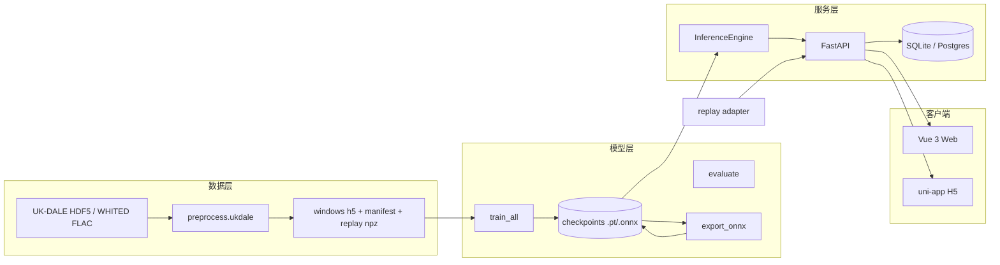

# NILM 系统现状梳理

> 核对时间：2026-11-11 08:00（以本机运行中的服务、数据库与文件为准）
> 结论：**系统链路已真实化并可运行**；**算法结论尚未成立**（attention 平均指标仍低于 baseline）。下面按"数据 → 模型 → 服务 → 客户端 → 运维"拆开说明。

---

## 1. 一句话定位

一套建筑级 NILM（非侵入式负荷监测）系统：用 **UK-DALE 真实数据**训练 Seq2Point 模型，导出 **ONNX**，由 **FastAPI** 提供分解/分析接口，**Vue Web** 与 **uni-app H5（全英文）** 展示实时总功率、家电分解、模型指标和用电账单。

---

## 2. 总体架构



---

## 3. 数据流

### 3.1 离线（训练前）

```text
data/raw/ukdale.h5
  └─ ml/preprocess/ukdale.py  (NILMTK PyTables 表 + Blosc)
       ├─ data/processed/ukdale_house1_{app}_{split}.h5   (x/y, float16/float32)
       ├─ data/processed/dataset_manifest.json            (stats/文件/窗口数/正例率)
       └─ data/processed/replay/ukdale_house1_day1.npz    (最后一天原始序列)
```

### 3.2 训练与导出

```text
dataset_manifest.json
  └─ train.train_all
       ├─ checkpoints/{app}_{model}.pt        (state_dict + stats + threshold)
       ├─ checkpoints/ablation_metrics.json   (测试集 MAE/SAE/state-F1/event-F1)
       └─ eval.export_thesis_tables           (thesis_exports/)
  └─ export.export_onnx --all
       ├─ checkpoints/{app}_{model}.onnx      (数值 parity 校验)
       └─ checkpoints/{app}_{model}.json      (stats/window/threshold/dataset)
```

### 3.3 在线（一次 Dashboard 刷新）

```text
Replay/Seed ──POST /measurements/upload──▶ measurements 表
Web ──GET /disaggregation/result(meter,start,end)──▶ FastAPI
      ├─ 命中 cache(meter|start|end|model_version) → 直接返回
      └─ 未命中 → 查询 measurements → 599 点滑窗 → 5 个 ONNX 批量推理
                → 按时间戳积分算电量 → 写 cache → 返回 JSON
Web ──GET /analytics/energy──▶ 最新 cache 的分项 + 总表积分
Web ──GET /analytics/reports──▶ ablation_metrics.json → 雷达图/表格
```

---

## 4. 模块地图

| 层 | 路径 | 职责 |
|----|------|------|
| 数据 | `data/raw/` | UK-DALE 5.47 GB zip + 6.33 GB h5；WHITED 225 MB |
| 数据 | `ml/preprocess/ukdale.py` | 读 NILMTK HDF5（`table/index/values_block_0`、Blosc），清洗、6 s 重采样、分窗、统计量、replay npz |
| 数据 | `ml/preprocess/whited.py` | WHITED 索引、19 维时频特征、按设备留出的电器识别实验 |
| 数据 | `ml/preprocess/cleaning.py` | 去负值/尖峰、短缺口插值、滑窗（numpy 视图） |
| 模型 | `ml/models/seq2point.py` | baseline / dilated / attention / 加权 Huber |
| 训练 | `ml/train/train_one.py` | 单电器训练、按 val MAE 存 best、val 上校准 event-F1 阈值 |
| 训练 | `ml/train/train_all.py` | 多模型多电器训练 + 测试集评测 + 消融表 |
| 评测 | `ml/eval/evaluate.py` | 统一指标 schema，加载 checkpoint 评测 |
| 导出 | `ml/export/export_onnx.py` | ONNX 导出 + PyTorch/ONNX 数值一致性 |
| 推理 | `ml/inference/engine.py` | 批量窗口推理、模型优先级（attention）、版本哈希、阈值 |
| 服务 | `backend/app/services/inference.py` | 取数 → 推理 → 积分 → 缓存；`/readyz` 状态 |
| 服务 | `backend/app/routers/*` | Auth / Buildings / Meters / Measurements / Events / Appliances / Disaggregation / Analytics |
| 服务 | `backend/app/services/energy.py` | 按真实时间戳积分 kWh |
| 服务 | `backend/app/services/metrics.py` | 读取并归一化消融指标 |
| 服务 | `backend/app/services/settings_store.py` | 阈值/电价/时区持久化 |
| 服务 | `backend/app/routers/datasets.py` | 数据集卡片（WHITED 索引 + 指标） |
| 客户端 | `web/src/views/*` | Dashboard / Evaluation / Analytics |
| 客户端 | `mobile/src/pages/*` | Monitor / Devices / Analytics / Profile（英文） |
| 运维 | `scripts/download_datasets.py` | 可续传下载 + SHA-256 清单 |
| 运维 | `scripts/extract_ukdale.py` | 从 zip 提取 h5 |
| 运维 | `scripts/smoke_api.py` | 21 项端到端 API 检查 |
| 运维 | `scripts/demo_web.ps1` / `demo_mobile.ps1` | 一键数据/训练/后端/前端 |

---

## 5. 当前运行状态（已实测）

| 项 | 值 |
|----|-----|
| 推理后端 | `onnx`，模型版本 `38a6469e6afe` |
| 活动模型 | attention（9,836,166 参数） |
| 采样周期 | 6 s；窗口 599（≈59.9 分钟） |
| 电器 | fridge / kettle / microwave / dishwasher / washing_machine |
| 数据库 | 1 用户 / 1 建筑 / 1 电表 / 5 电器 / 14,679 条测量（约 24 h） |
| 缓存/任务 | 6 条分解缓存 / 2 个任务 / 1 条告警（System Ready） |
| API | http://127.0.0.1:8000（`/docs`、`/readyz`） |
| Web | http://localhost:3000 |
| 移动端 H5 | http://127.0.0.1:3100 |
| 检查结果 | `smoke_api.py` 全部通过；2 h 窗口 240 点、首次 0.18 s、推理 64.5 ms |
| WHITED | 994 暂态 / 40 类 / 100 设备；设备留出 18/40 类，acc 44.1%、macro-F1 27.0%、top-3 71.8% |

---

## 6. 数据资产

| 资产 | 大小 | 说明 |
|------|------|------|
| `data/raw/ukdale.h5.zip` | 5.47 GB | 官方 CEDA 包，可续传 |
| `data/raw/ukdale.h5` | 6.33 GB | 已解压，NILMTK HDF5 |
| `data/raw/whited/` | 225 MB / 994 FLAC | 启动暂态数据（尚未接入 UI） |
| `data/processed/ukdale_house1_*_train.h5` | 37.7 MB × 5 | 60,797 窗口/电器 |
| `data/processed/ukdale_house1_{val,test}.h5` | 6.8 MB × 5 × 2 | 13,013 窗口/电器 |
| `ml/checkpoints/` | 1.58 GB / 38 文件 | 10 个 ONNX + 10 个 .pt + 元数据 |
| `ml/checkpoints/whited_*` | ~31 MB | 识别指标、索引、特征矩阵、随机森林分类器 |
| `backend/nilm.db` | 2.72 MB | SQLite（schema 重建后） |

数据覆盖：2014-01-01 → 2014-06-30（UTC），2,606,400 个 6 s 样本。
测试集正例率（按阈值）：fridge 46.6%、kettle 0.47%、microwave 0.26%、dishwasher 2.09%、washing_machine 3.87%。

---

## 7. 模型与指标

| 电器 | Attention MAE | SAE | State F1 | Event F1 | Baseline MAE | State F1 | Event F1 |
|------|--------------:|----:|---------:|---------:|-------------:|---------:|---------:|
| fridge | 21.31 | 0.006 | 0.781 | 0.861 | 20.53 | 0.784 | 0.872 |
| kettle | 9.21 | 0.153 | 0.744 | 0.755 | 8.14 | 0.821 | 0.835 |
| microwave | 6.76 | 0.345 | 0.152 | 0.288 | 7.08 | 0.329 | 0.413 |
| dishwasher | 8.72 | 0.105 | 0.845 | 0.810 | 9.53 | 0.724 | 0.759 |
| washing_machine | 11.15 | 0.013 | 0.884 | 0.840 | 13.38 | 0.952 | 0.909 |
| **均值** | — | — | **0.681** | **0.711** | — | **0.722** | **0.758** |

**解读**

- attention 在洗碗机、洗衣机上更好，尤其洗衣机 SAE 0.013 vs 0.316。
- 水壶、微波炉上 baseline 更好；微波炉两者都差（正例仅 0.26%）。
- 平均值上 attention 尚未超过 baseline。**当前不能宣称"改进模型更优"**，这是论文/答辩最大的风险点。
- 模型选择、阈值搜索都在验证集完成，未使用测试集调参。

---

## 8. API 地图（38 个路径）

| 分组 | 主要端点 |
|------|----------|
| 认证 | `POST /auth/login` `POST /auth/logout` `POST /auth/refresh` `GET /auth/me` |
| 建筑 | `GET/POST /buildings` `GET/PUT/DELETE /buildings/{id}` `GET/POST /buildings/{id}/floors` `GET/POST /floors/{id}/zones` |
| 电表 | `GET/POST /meters` `GET/PUT/DELETE /meters/{id}` `GET /meters/{id}/current` `GET /meters/{id}/status` |
| 测量 | `GET /measurements/realtime` `GET /measurements/history` `POST /measurements/upload` |
| 事件 | `GET /events` `GET /events/{id}` `POST /events/upload` |
| 家电 | `GET/POST /appliances` `GET/PUT/DELETE /appliances/{id}` `GET /appliances/{id}/usage` |
| 分解 | `GET /disaggregation/result` `POST /disaggregation/run` `GET /disaggregation/status/{id}` `GET /disaggregation/overview` `GET /disaggregation/models` |
| 分析 | `GET /analytics/overview` `GET /analytics/energy` `GET /analytics/alerts` `POST /analytics/alerts/{id}/resolve` `GET /analytics/metrics` `GET /analytics/reports` `GET/PUT /analytics/settings` |
| 数据集 | `GET /datasets/whited` |
| 探活 | `GET /health` `GET /healthz` `GET /readyz` |

约定：UTC + `Z`；分页 ≤500；区间 ≤31 天；上传 ≤10,000 条；`(meter_id,timestamp)` 唯一。

---

## 9. 客户端

### Web（双语）

- **Dashboard**：建筑/电表选择、后端与模型版本、KPI、总功率+分解曲线、家电卡片、手动刷新（异步任务）。
- **Evaluation**：雷达图（State F1 / Event F1 / Precision / Recall / SAE Score）+ 10 行真实指标表 + WHITED 电器识别卡片（设备留出指标）。
- **Analytics**：分项电量/电费 + 未分解电量、阈值/电价持久化、告警处理。

### 移动端（全英文）

- Tab：Monitor / Devices / Analytics / Profile。
- 设备名与告警由客户端按 `type`/`title_en` 映射为英文（后端数据仍是中文名）。
- Node ≥ 22.12（项目内置 `.tools/node-v22.14.0-win-x64`），构建产物 `mobile/dist/build/h5`。

---

## 10. 真实 / 近似 / 遗留

| 类别 | 内容 |
|------|------|
| **真实** | UK-DALE 数据、训练、ONNX 推理、测试集指标、总电量积分、告警、`/appliances/{id}/usage`（已改为读取最新分解窗口） |
| **配置默认值** | 电价 0.6 元/kWh、过载阈值 3000 W、时区 Asia/Shanghai、告警冷却 10 min（可在 Analytics 修改） |
| **近似** | `confidence` 使用模型 event-F1 作为展示值，不是逐点置信度；`unmetered` 是总电量减分项和；`activeDevices` 来自最新一次缓存 |
| **遗留** | `archive/legacy_nilm/`（仅归档，不在运行链路）；MQTT/Modbus 为实验性 stub；`openapi/NILM.json` 已由 FastAPI 自动生成 |
| **WHITED（已接入）** | 994 暂态 / 40 类 / 100 设备；设备留出下 18/40 类可评测，RF acc 44.1%、macro-F1 27.0%、top-3 71.8% |
| **已修复** | 评估页假分数、日期缓存键、时区偏移、Docker 启发式回退（compose 已补 `./ml:/ml`）、移动端中文标签 |

---

## 11. 风险与缺口（按优先级）

### P0（影响论文/答辩）

1. **模型叙事不成立**：attention 平均 State/Event F1 均低于 baseline，需要改进或如实改写结论。
2. **微波炉过差**：F1 0.152/0.288，正例 0.26%；需要 focal/二阶段分类头/更强正样本权重。
3. **只有单房屋**：所有结论仅限 UK-DALE house 1，不能声称泛化。

### P1（工程）

4. 无单元测试/CI，只有 `smoke_api.py`。
5. 无 Alembic；改 schema 只能删库重建（本轮已发生一次）。
6. Docker 镜像本身仍未 `COPY ml/`（compose 用 volume 兜底）；生产构建需把推理包化。
7. 认证/授权薄弱：默认 JWT secret、无 RBAC、refresh 可复用、无登录限流。
8. 上传去重是"先查后插"，并发重复批次可能触发唯一约束 500。
9. 缓存/任务无 TTL 与清理；长期 replay 会持续增长。
10. 长区间分析（30 天）把全部测量读进 Python，1 Hz 数据会吃内存。
11. `openapi/NILM.json` 与实现漂移；应以 FastAPI `/docs` 为准。
12. 移动端 `API_BASE` 写死 127.0.0.1；真机需手改。

### P2（体验/优化）

13. ONNX 合计 1.55 GB（baseline 117 MB ×5），可量化/蒸馏。
14. 30 秒轮询而非 SSE/WebSocket。
15. WHITED 手工特征基线偏弱（acc 44.1%），可换原始波形 1D-CNN。
16. Windows 脚本为主，`.sh` 仍是旧合成流程；`ml/eval` 包名与内置 `eval` 同名（可改 `evaluation`）。

---

## 12. 建议的下一步（2–3 周）

1. **公平对比 + 改进**：attention 与 baseline 同损失/同轮数；加分类辅助头或 focal；训练 10 epoch；再决定论文主张。
2. **跨房屋**：house 1 训练 → house 2 测试，补泛化表。
3. **工程护栏**：pytest + CI、Alembic、RBAC/secret、Docker 构建。
4. **实时化**：SSE 替换轮询；缓存/任务 TTL。
5. **WHITED 深度学习**：用原始波形 1D-CNN 替换手工特征（当前 strict 基线 acc 44.1%）。
6. **答辩材料**：系统图、真实指标表、失败案例分析（微波炉）、局限声明。

---

## 13. 快速入口

```powershell
# 一键（已有数据/模型）
.\scripts\demo_web.ps1
.\scripts\demo_mobile.ps1

# 验证
backend\.venv\Scripts\python.exe scripts\smoke_api.py
curl http://127.0.0.1:8000/readyz

# 重建数据/模型
python scripts/download_datasets.py --dataset ukdale
python scripts/extract_ukdale.py
cd ml
.\.venv\Scripts\python.exe -m preprocess.ukdale --h5 ..\data\raw\ukdale.h5 --house 1
.\.venv\Scripts\python.exe -m train.train_all --models attention baseline --epochs 3 --device cuda
.\.venv\Scripts\python.exe -m export.export_onnx --all
```

---

*本文档基于运行中的系统核对；若后续修改 schema/模型，请同步更新第 5、7、11 节。*
