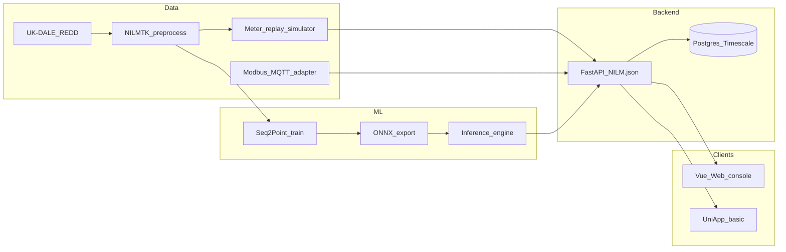

# Building-Level NILM Implementation Plan

## Locked decisions

- **Scope**: full system (pipeline, model, backend, Web, mobile code).
- **Demo path**: Web + simulated building replay; optional real-meter adapter. **No mobile demo** (App still shipped as a basic client, not required for defense demo).
- **API contract**: implement [NILM.json](NILM.json) (`/api/v1`, JWT, Building → Floor → Zone → Meter → Measurements / Events / Disaggregation / Appliances / Analytics).
- **Reuse**: extract and extend existing Vue mock console from [NILM.tar](NILM.tar) (`nilm-web-console`: Dashboard / Evaluation / Analytics, Element Plus + ECharts, currently mock APIs).
- **Stack**: Python 3.11 + FastAPI + SQLAlchemy + PostgreSQL/TimescaleDB; PyTorch train → ONNX Runtime serve; Vue 3 Web; Uni-app mobile (Vue-aligned with 金欣怡).

## Target architecture




## Repo layout (create under workspace)

```
NILM/
  openapi/NILM.json          # copy of contract
  data/                      # scripts + cached windows (git-lfs or local only)
  ml/                        # train, eval, export
  backend/                   # FastAPI app
  web/                       # from nilm-web-console
  mobile/                    # Uni-app skeleton
  adapters/                  # simulator + optional Modbus/MQTT
  docker-compose.yml
```

---

## Phase 1 — Data pipeline (M1–M2)

**Goal**: reproducible UK-DALE (primary) / REDD windows for N-to-1 Seq2Point.

1. NILMTK loaders for house-level aggregate + appliance channels.
2. Clean: drop negative/spike outliers; align timestamps; interpolate short gaps, drop long gaps.
3. Keep **1 Hz** LF; downsample HF if used.
4. Sliding window: `W=599`, stride for train (e.g. 1 or subsampled), label = mid-window appliance power (Seq2Point).
5. Per-appliance z-score / max normalization; persist stats with checkpoints.
6. Output HDF5/NPY + a `dataset_manifest.json` (house, appliance, split dates).
7. Target appliances (Type coverage): fridge, kettle, microwave, dishwasher, washing machine; AC if available in house.

**Deliverable**: `ml/preprocess/` CLI that regenerates train/val/test from raw dataset paths.

---

## Phase 2 — Seq2Point model + ONNX (M2–M5)

**Baseline** (from [pre.pdf](pre.pdf)): 5× Conv1D → Dropout → Dense(1024) → Dense(1), **one model per appliance (N-to-1)**.

**Improvement path** (ablation order):

1. Baseline Seq2Point
2. Dilated Conv1D (rates 1,2,4,8…)
3. Temporal / channel attention
4. Huber + positive-sample weighting (address ON/OFF imbalance)

**Metrics**: MAE, SAE, Acc/F1 (ON if power > threshold).

**Serving**: export each appliance to ONNX; `ml/inference/` loads ONNX Runtime session, takes last `W` aggregate samples, returns mid-point power. Batch windowed replay for day-level disaggregation series.

**Deliverable**: trained weights + `export_onnx.py` + unit test that ONNX matches PyTorch within tolerance.

---

## Phase 3 — Backend API + DB (M3–M6)

Implement FastAPI against [NILM.json](NILM.json):


| Module         | Endpoints (core)                                                      |
| -------------- | --------------------------------------------------------------------- |
| Auth           | login / refresh JWT; roles `system_admin`, `building_admin`, `tenant` |
| Buildings      | CRUD buildings, floors, zones                                         |
| Meters         | CRUD meters; current reading; ingest samples                          |
| Measurements   | time-range query (Timescale hypertable)                               |
| Events         | list/create ON/OFF/state_change (rule or CUSUM-lite later)            |
| Disaggregation | run job for meter+period; fetch `DisaggregationResult` + series       |
| Appliances     | inventory linked to meter/zone                                        |
| Analytics      | overview, top appliances, floor breakdown                             |


**Inference wiring**: async job or sync endpoint that pulls meter series → sliding windows → ONNX per appliance → persist `ApplianceEnergy` + series.

**Seed**: one demo building mapped from UK-DALE house (e.g. Building A / Floor 1 / Zone office / Meter 101).

---

## Phase 4 — Simulated building + optional real meter (demo)

**Simulator** (`adapters/replay/`):

- Replay UK-DALE 1 Hz aggregate into `POST /meters/{id}/measurements` (or internal ingest).
- Optionally publish MQTT for realism.
- Wall-clock or accelerated time for live Web charts.

**Optional real adapter** (`adapters/modbus_mqtt/`):

- Interface: `MeterSource.read()` → normalized samples.
- Implementations: `ReplaySource`, `MqttSource`, `ModbusTcpSource` (stub + config).
- Demo default = Replay; enable Modbus via env when hardware available.

---

## Phase 5 — Web console (primary demo)

Extract [NILM.tar](NILM.tar) → `web/`, then:

1. Replace mocks in `src/api/disaggregation.js` with real axios calls to FastAPI.
2. Align UI entities with building hierarchy (building/meter selectors).
3. Keep pages: **Dashboard** (live mains + appliance stack), **Evaluation** (MAE/SAE/F1 radar vs baseline), **Analytics** (energy share / billing-style breakdown).
4. Vite proxy `/api/v1` → backend; JWT login page.
5. Demo script: start compose → seed → start replay → open Dashboard → show disaggregation + metrics.

---

## Phase 6 — Mobile (build, no demo)

Uni-app minimal client (login, live total power, appliance list, daily energy). Same JWT APIs. **Not** in defense demo script; smoke-test against backend only.

---

## Phase 7 — Integration, eval, thesis artifacts (M6–M12)

- Cross-house / REDD generalization table.
- Ablation table (baseline → dilated → attention → loss).
- Load test ingest + inference latency.
- Docker Compose one-command demo for Web path.
- Thesis figures from Evaluation page + CSV metrics export.

---

## Team ownership (aligned with NILMpre)

- **金欣怡**: preprocess, FastAPI, DB, Web (extend existing console), simulator seed.
- **杨一飞**: Seq2Point train/ablation, ONNX engine, metrics.
- **余升斌**: Uni-app basic client + API wiring (no demo polish).

## First implementation slice (when you approve execution)

1. Scaffold monorepo + docker-compose (Postgres).
2. Extract web from `NILM.tar`.
3. FastAPI skeleton + Auth + Buildings/Meters matching OpenAPI.
4. Preprocess UK-DALE fridge/kettle windows + baseline Seq2Point train script.
5. Replay adapter + wire Dashboard to live disaggregation.

